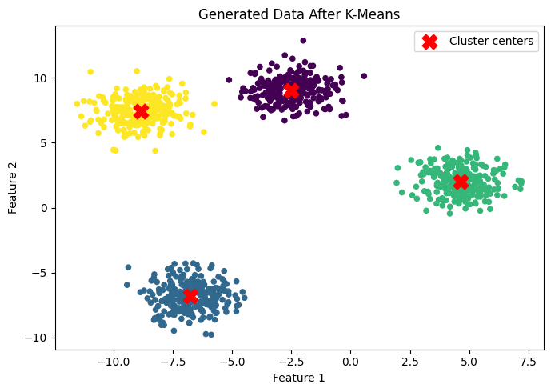
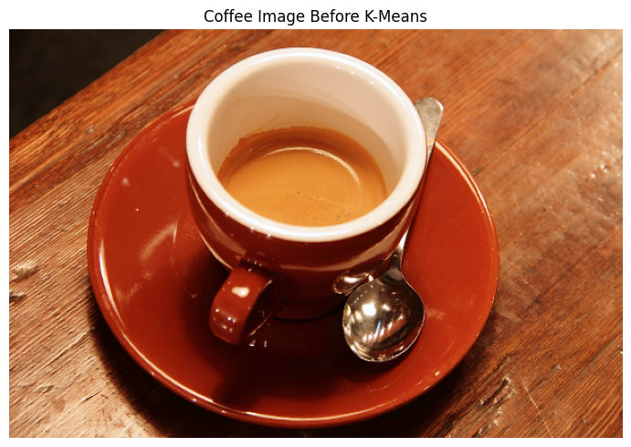
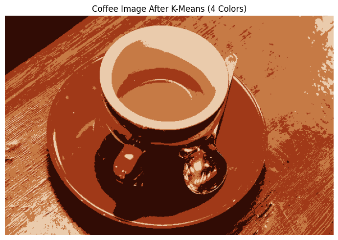
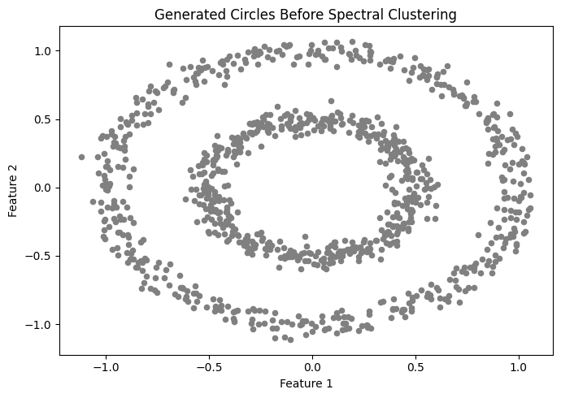
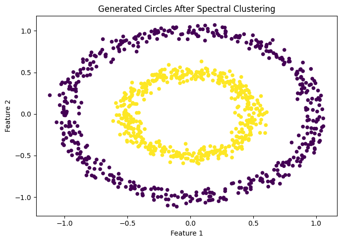
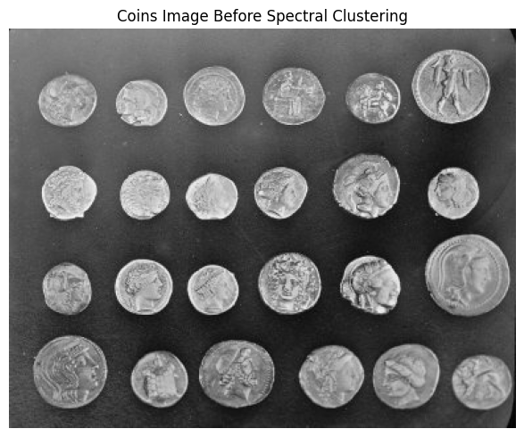
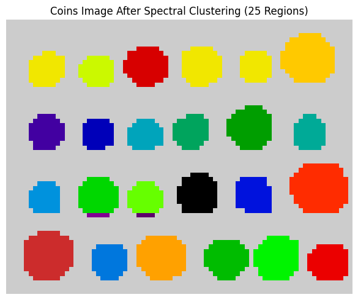

# Image Clustering- K-Means and Spectral Clustering
 K-Means and Spectral Clustering on generated datasets and real images using Python.

## Course
BSCS 4388 – Computer Vision

## Project Description
This project applies two clustering algorithms, K-Means and Spectral Clustering, using Python. Both algorithms are tested on generated datasets and real images to see how they group data points and divide images into different regions.

## Objectives
- Apply K-Means clustering to generated data and a real image.
- Apply Spectral Clustering to generated data and a real image.
- Plot the data before and after clustering.
- Save the results as image files.

## Technologies Used
- Python 3
- NumPy
- Matplotlib
- Scikit-learn
- Scikit-image

## Datasets
### Lab 1: K-Means
1. **Generated Data:** 1,000 samples with 4 centers.
2. **Coffee Image:** The coffee image provided by `skimage.data.coffee()`.

### Lab 2: Spectral Clustering
1. **Generated Data:** 1,000 samples arranged in two circles.
2. **Coins Image:** The coins image provided by `skimage.data.coins()`.

## Project Files
- `kmeans_clustering.py` – Code for K-Means clustering.
- `spectral_clustering.py` – Code for Spectral Clustering.
- `BSCS_4388_Lab1_2_Clustering.ipynb` – Jupyter Notebook containing the lab steps and outputs.

## Output Images
## Lab 1: K-Means Clustering

**Generated Data Before Clustering**

 

**Generated Data After Clustering**



**Coffee Image Before Clustering**



**Coffee Image After Clustering**



---

## Lab 2: Spectral Clustering

**Generated Data Before Clustering**



**Generated Data After Clustering**



**Coins Image Before Clustering**



**Coins Image After Clustering**



## Installation
Install the required libraries by running:

```bash
pip install numpy matplotlib scikit-learn scikit-image
```

## How to Run
Run either Python script from the terminal:

```bash
python kmeans_clustering.py
```

```bash
python spectral_clustering.py
```

You can also open `BSCS_4388_Lab1_2_Clustering.ipynb` in Jupyter Notebook and run the cells in order.

## Conclusion
This lab helped me practice using K-Means and Spectral Clustering on generated datasets and real images. The results show how clustering can group similar data points and separate different regions in an image.
